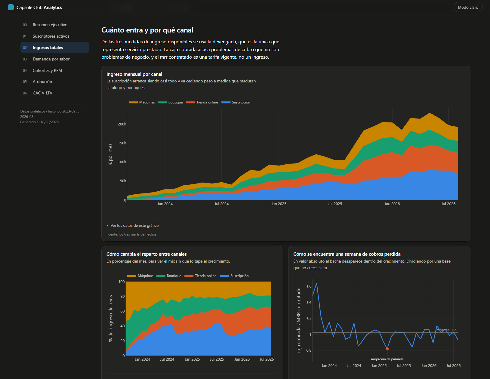
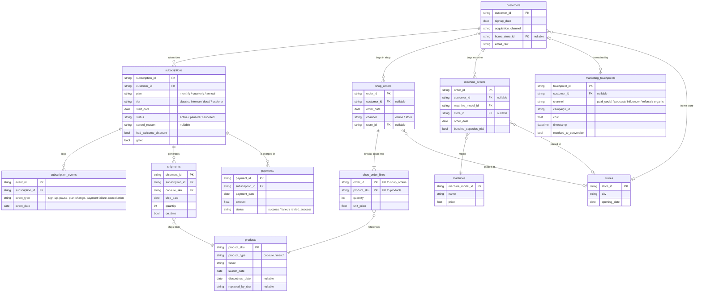
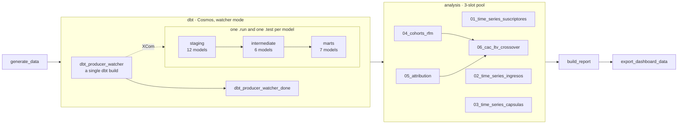

# Capsule Club Analytics

### 👉 **[See the live interactive report](https://diegoprieto23.github.io/capsule-club-analytics/)**

[](https://diegoprieto23.github.io/capsule-club-analytics/)

*The report itself is written in Spanish.*

---

## About

An end-to-end analytics project on a simulated coffee capsule business. It
covers the whole journey: generating the dataset, modelling it in dbt on
DuckDB, six analyses in Python, a seven-page interactive HTML report as the
deliverable, and an Airflow DAG that chains all of the above.

**What it does, in five pieces:**

1. **Generates** a three-year synthetic business with 280,841 rows across
   twelve tables —subscription club, online shop, boutiques and machine
   sales— with defects injected on purpose: stockouts, a lost week of
   payments, duplicated customers and a marketing channel that stops being
   measurable for six months.
2. **Models** that raw data into seven analytical tables, through a cleaning
   layer and a business-logic layer, with 220 automated checks that run on
   every build.
3. **Analyses** those tables with three techniques that build on each other
   —time series, cohorts and RFM, and multi-model marketing attribution— up
   to the crossover that closes them: CAC by channel against the LTV that
   channel ends up bringing in.
4. **Publishes** a static seven-page HTML report: Plotly charts with their
   data table underneath, light and dark mode, and 23 recommendations, each
   with the figure that backs it.
5. **Orchestrates** the four previous steps in a single Airflow 3 DAG, with
   dbt inside thanks to Cosmos: one task per model and one for its tests.

The seven chapters follow a single question: **which acquisition channel is
worth it** when measured by what the customer ends up leaving rather than by
what it costs to bring them in. The answer flips the ranking.

**Stack:** Python 3.13 · DuckDB · dbt · Airflow 3 + Cosmos (Astro CLI) ·
pandas · statsmodels · Plotly. Everything runs locally, with no paid services.

## The simulated business

Capsule Club is a coffee capsule brand that does not exist. It sells in four
ways at once: a subscription club that ships capsules every month, an online
shop, a handful of physical boutiques, and coffee machines as a one-off
purchase.

The whole business is simulated: three years of history and 280,000 rows.

The result is **a seven-page report** that opens with an executive summary
and ends with an action plan. Each page tells one finding, shows it with a
chart and ends with concrete recommendations: what to do, why, what it is
worth and which metric will tell whether it worked.

## What's inside the report

| Page | What it answers |
|---|---|
| **Executive summary** | The five levers that move the most money, ranked by return against cost |
| **Active subscribers** | How many there are, how the base has grown and where its seasonality lies |
| **Total revenue** | Where the money comes from, how the channel mix shifts and where a lost week of payments was hiding |
| **Demand by flavour** | How many capsules of each flavour to buy, with stockouts netted out |
| **Cohorts and RFM** | How long a customer lasts, what makes them leave and which buyer groups deserve different treatment |
| **Attribution** | Which channel deserves credit for each sign-up, and how much marketing cannot be attributed to anyone |
| **CAC × LTV** | What it costs to acquire a customer against what they end up leaving, channel by channel |

### Some of the findings

- **The cheapest channel is not the most valuable one.** Podcasts acquire
  subscribers for €13.52 and *paid social* for €14.44, but the latter retains
  ten points better at one year and ends up returning more (37.3x vs 33.7x).
  Ranking channels by acquisition cost gives the reverse order of ranking them
  by value.
- **39.4% of marketing cannot be attributed to any conversion.** It is not
  wasted spend, but it is not optimisable either: nobody knows who it reached.
  Loading that orphan spend onto sign-ups raises the average CAC from €11.71
  to €14.53, and not evenly across channels —*paid social* goes up 44%— so it
  reorders the ranking.
- **Six stockouts** left €17,119 of capsules unsold. In the data, a day
  without stock is a zero identical to a day without demand; they are told
  apart by testing the expected demand inside each run of zeros, using the
  club —which never runs out of stock— as a control group: 6 out of 44
  candidates, with no false positives.
- **The welcome discount shortens customer lifetime by 5.1 months** (16.7 vs
  21.8) and takes about €128 of LTV off each sign-up. Rather than building
  loyalty, it selects: it separates those who were going to stay from those
  who came for the discount.
- **274 cancellations originate in a failed payment**, not in a customer
  decision, and there is no recorded recovery attempt.

## The data

280,841 rows across twelve tables, from September 2023 to August 2026. They
are produced by a script with a fixed seed, so two runs produce exactly the
same output.

**The data is broken on purpose.** There are stockouts that look like lack of
demand, a week of payments lost in a migration, gifted subscriptions mixed in
with real ones, a marketing channel that stopped being measurable for six
months, and customers duplicated by typing the same email in two different
ways. None of these anomalies is flagged in the data: they are detected, their
effect is measured and they are documented in the report instead of being
silently fixed. The full catalogue is in `docs/data_imperfections.md`.

| Table | Rows | What it is |
|---|---:|---|
| `customers` | 12,305 | Customers, whether subscribers, buyers or both |
| `subscriptions` | 5,110 | Club subscriptions, with their plan and status |
| `subscription_events` | 12,385 | Sign-ups, pauses, plan changes, payment failures and cancellations |
| `shipments` | 45,508 | Club shipments, with the flavour of each capsule |
| `shop_orders` / `shop_order_lines` | 39,888 / 82,925 | Online shop and boutique orders |
| `machine_orders` | 3,417 | Machine sales |
| `payments` | 32,726 | Subscription payments |
| `marketing_touchpoints` | 46,541 | Every marketing touch before a sign-up |
| `products` · `machines` · `stores` | 23 · 5 · 8 | Catalogue and stores |

### The model

The data comes in raw and leaves as seven tables ready for analysis. In
between there is a cleaning layer (`staging`) and another one that resolves
the hard business logic (`intermediate`): merging duplicated customers,
rebuilding the marketing journey of each sign-up, computing the state of each
subscription month by month.

This is how it comes in, exactly as the generator leaves it:



The optional ends of the diagram are deliberate, and they are the ones that
make the work: an order may have no customer (a boutique purchase without a
loyalty card, 27.4% of shop orders), a marketing touch may resolve to nobody
—39.4%— and a customer may have no home store because they signed up online.
Each of those gaps forces an explicit decision before anything can be
measured.

The seven final tables the analyses consume:

| Table | Grain | What for |
|---|---|---|
| `dim_customers` | Customer | Who they are, where they came from, how much they have spent |
| `dim_subscriptions` | Subscription | When it started, which plan, whether it is still alive |
| `fct_subscriptions_monthly` | Subscription × month | The monthly snapshot: active, paused or cancelled, and how much fee |
| `fct_shipments` | Shipment × flavour | Which capsules went out and when |
| `fct_shop_orders` | Order | Online shop and boutique purchases |
| `fct_machine_orders` | Order | Machine sales |
| `fct_marketing_attribution` | Sign-up | The journey of touches that led to each subscription |

Every table has its automated checks: no duplicates, no missing mandatory
fields, no reference pointing to nothing, amounts that add up. **220 checks
in total**, and all of them pass on every run. That is what makes it possible
to tell a real anomaly in the data apart from a pipeline error.

## What was measured

**Time series.** Three series —subscribers, revenue and capsules by flavour—
split into trend, seasonality and noise. The business turns out to run on two
different calendars: a yearly one (weak August, strong March) and a weekly
one that only shows up in sign-ups, not in the customer count. And the two
seasonal flavours, 9% of volume, are the ones that set the year's purchasing
calendar.

**Cohorts and retention.** Each group of sign-ups is followed month by month
to see how many stay and when they leave. Two things that only show up this
way: acquisition channels look identical at three months and do not split
until after a year, and the gap between "customers who stay" and "money that
keeps coming in" is not opened by plan changes —which weigh nothing— but by
pauses, which explain 102% of the difference.

**RFM segmentation.** Shop buyers grouped by when they last bought, how often
and how much they spent. Champions are one in six customers and almost a
third of revenue, and most of them have no subscription.

**Marketing attribution.** Four ways of splitting credit across channels: all
to the first touch, all to the last, equal parts, and a Markov model that
measures how much conversion would drop if a channel disappeared. All four
give nearly the same answer —3.6 points of maximum spread and the same channel
order— while 39.4% of spend cannot be assigned to anyone: picking the right
model matters far less than fixing the measurement.

**Cost against value.** The closing piece: what it costs to acquire a
customer through each channel against what that customer ends up leaving.
With two caveats published alongside the result: the ratios come out too high
because the dataset has no COGS and LTV is revenue, not margin; and the podium
changes depending on the criteria used, by up to 66% in the ratio of a single
channel. That is why the ranking is recomputed for every combination of
criteria —observed or projected LTV, CAC with or without orphan spend— and
the report shows how the podium changes in each one.

**Action plan.** Each page ends with recommendations: 23 in total, spread
across the seven pages, each with the figure that backs it. The executive
summary gathers the five with the highest return.

## How it's built

Python, DuckDB and dbt for the data; pandas and statsmodels for the analysis;
Plotly for the charts; Airflow 3 with Cosmos to orchestrate it all. Everything
runs on a laptop, with no paid services.

The report is static HTML: it opens with a double click, needs no server and
makes not a single request to the internet. It has light and dark mode, every
chart carries its data table underneath so colour is never the only way to
read a value, and the colours are chosen with a validator that checks they
remain distinguishable under colour blindness.

No figure in the text is written by hand: they are all read from the analysis
outputs, so the report cannot drift out of sync with the data. The last task
of the pipeline exports those same figures to flat CSVs in `dashboard/data/`,
without recomputing any of them.

### Orchestration

The `capsule_club_pipeline` DAG chains the five steps of the pipeline. It is
triggered manually, with no schedule. It has 61 tasks: dbt contributes two
per model (`.run` and `.test`), grouped by layer, and each notebook has its
own.



- **`generate_data`** writes the raw parquet files and `warehouse.duckdb`.
- **`dbt`** builds the seven final tables and runs the 220 checks.
- **`analysis`** runs the six notebooks with papermill. 01 to 05 only read
  DuckDB tables and run in parallel; 06 waits for 04 and 05 because it
  crosses their results. They share a three-slot pool: with five at once,
  DuckDB ran out of memory inside the Docker virtual machine.
- **`build_report`** generates the report and **`export_dashboard_data`**, the
  CSVs.

**Why Cosmos watcher mode.** DuckDB allows a single writer process on the
file. Cosmos's default mode launches one `dbt run` per model, in parallel, and
hits the write lock (`Could not set lock on file`). In watcher mode a single
producer task launches a single `dbt build` —the same command as locally,
with the four threads from `profiles.yml`— and each model's task and its tests
task just watch it: one writer by construction, without having to serialise
anything through a pool. If the `dbt build` fails, the
`dbt_producer_watcher_done` gate propagates it and nothing downstream starts.

The DAG is parsed from dbt's `manifest.json`, which is generated when the
image is built, rather than by running dbt every time. The image separates
three environments —Airflow with Cosmos, dbt, and the analysis stack— each in
its own venv, so their dependencies do not clash.

### Running it locally

There are two paths, and both produce the same result.

#### With Airflow

Requires [Docker Desktop](https://www.docker.com/products/docker-desktop/) and
[Astro CLI](https://www.astronomer.io/docs/astro/cli/install-cli). Commands are
run from the repository root.

1. **Start Airflow.** With Docker Desktop open:

   ```bash
   astro dev start
   ```

   The first time it builds the image and takes a few minutes; after that it
   starts in seconds. It ends by printing the UI address.

2. **Open the UI** at <http://localhost:8080>. Locally it does not ask for a
   user.

3. **Find the DAG.** In **Dags** → `capsule_club_pipeline`. The toggle must be
   on: a paused DAG leaves runs queued. The **Graph** tab draws the pipeline,
   with the `dbt` and `analysis` groups expandable; **Grid** shows each run
   task by task.

4. **Trigger it** with the **Trigger** button, or from the terminal:

   ```bash
   astro dev run dags trigger capsule_club_pipeline
   ```

   It generates the dataset, builds the tables, runs the six notebooks,
   rebuilds the report and exports the CSVs. It takes about two minutes and
   finishes with all 61 tasks green. Each task's log opens from **Grid**; the
   one for `dbt.dbt_producer_watcher` holds the full `dbt build`, which ends in
   `PASS=245`.

5. **Open the report** at `report/dist/index.html`, with a double click. The
   "Generado el …" date in the header is the run date.

6. **Shut it down** with `astro dev stop`, which stops the containers without
   deleting anything. If something fails on startup, `astro dev logs` shows
   the logs.

Before triggering the DAG, close any notebook or Python session that has
`data/warehouse.duckdb` open outside the container: DuckDB's write lock is the
same one.

What the DAG writes reaches the repository through Docker volumes: `data/`,
`analysis/outputs/`, `report/dist/` and `dashboard/data/`. Each executed
notebook is saved next to its task's log; the ones in `analysis/` are left
untouched. The rest of the code is baked into the image, so a change to the
notebooks, the generator, the report or `dbt_project/` requires
`astro dev restart`; only `dags/` is hot-reloaded.

#### Without Airflow

Requires Python 3.13. The commands are for Windows; on Linux or macOS, replace
`venv\Scripts\` with `venv/bin/`.

```bash
python -m venv venv
venv\Scripts\pip install -r requirements.txt

# 1. Generate the dataset (~15 s)
venv\Scripts\python data_generation\generate_synthetic_data.py

# 2. Build the tables and run the checks
cd dbt_project
..\venv\Scripts\dbt build --profiles-dir .

# 3. Rebuild the report
cd ..
venv\Scripts\python report\build_report.py
```

Step 3 reads the results from `analysis/outputs/*.json`, which are **not**
versioned because they can be regenerated. On a fresh clone you first need to
run the six notebooks in `analysis/`, each of which leaves its output there.
With Airflow, the `analysis` group takes care of that.

Either way, the report ends up in `report/dist/index.html`, and that folder is
versioned: it is the deliverable, and the GitHub Actions workflow publishes it
to Pages as is, without rebuilding anything.

### Where everything lives

```
data_generation/            synthetic dataset generator
dbt_project/                the transformations and their checks
analysis/                   six notebooks, one per analysis
report/                     the HTML report generator
dashboard/                  export of the report's figures to flat CSVs, with their data dictionary
dags/                       the Airflow DAG that chains everything
docs/                       data schema, imperfections catalogue and report structure
requirements/               dependencies split by environment: analysis, dbt and Airflow
Dockerfile                  Astro Runtime image with the dbt and analysis venvs
docker-compose.override.yml volumes that bring what the DAG writes back into the repository
airflow_settings.yaml       the notebooks pool, for local Airflow
```
